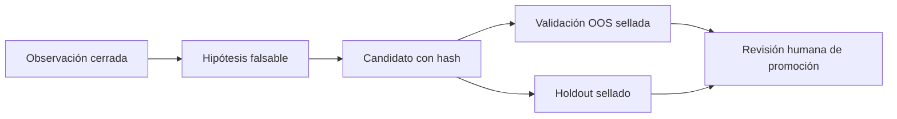

# Evidencia recursiva de cartera

`recursive_evidence.py` convierte observaciones de posiciones reales en
evidencia de investigación reproducible. No modifica MacroFlow, no envía
órdenes, no publica indicadores y no activa modelos. Su única función es
registrar hechos, bloquear inferencias prematuras y conservar la trazabilidad
entre una observación y una eventual revisión humana.

## Qué registra

Cada observación de cartera contiene:

- posiciones de una cesta y su posible relación común;
- feed, temporalidad, hora con zona, modelo y valores de indicadores por activo;
- TP y SL originales, junto con cualquier actualización y su motivo;
- PnL, MFE, MAE y slippage cuando existen; `null` significa que el dato no fue
  observado y evita inventarlo;
- escenarios de sensibilidad a gaps;
- concentración por posición y riesgo agregado;
- una decisión humana que distingue `new_entry_signal` de
  `manage_existing`;
- resultado final abierto, cerrado, cancelado o desconocido.

Los contratos son:

- `contracts/portfolio-observation.schema.json` para la observación completa;
- `contracts/indicator-batch.schema.json` para capturas de indicador todavía
  no reconciliadas con todos los datos del broker.

La captura sanitizada del 19 de octubre está en
`projects/macroflow/evidence/LIVE_INDICATOR_SNAPSHOTS_2026-10-19.json`. Conserva
los feeds `NQ1!`, `ES1!` y `RTY1!`, sus marcos de 5 minutos y las horas exactas
UTC+2. No contiene identificador de cuenta. Su estado es `open_unresolved` y
`promotion_eligible=false`.

`SIN OPERACIÓN` en esa captura significa que MacroFlow no emitía una entrada
nueva. No decide por sí mismo mantener, cerrar ni mover TP/SL de posiciones ya
abiertas; esas acciones pertenecen a `manage_existing` y deben quedar
registradas por separado.

## Secuencia obligatoria



1. **Observación:** admite casos abiertos o incompletos para no perder
   evidencia. Un caso abierto no puede alimentar una hipótesis.
2. **Hipótesis:** requiere varias observaciones distintas, cerradas y con
   validación de cartera realizada. Para ser elegible, cada posición también
   debe conservar PnL realizado, MFE, MAE, slippage observado y al menos un
   escenario de gap; los casos incompletos siguen archivados, pero no entrenan
   el ciclo.
3. **Candidato:** referencia la hipótesis y el hash exacto del artefacto.
4. **Validación:** cada muestra debe estar sellada antes de evaluarse, no haber
   sido usada para diseñar el candidato y corresponder al mismo hash. Un
   `sample_id` o `dataset_hash` no puede consumirse dos veces.
5. **Promoción:** debe declarar todas las validaciones realizadas sobre el
   candidato; una validación fallida no puede ocultarse seleccionando solo los
   resultados favorables. Solo registra una decisión humana para el repositorio
   de investigación. Nunca publica ni opera.

## Política preregistrada

Los tamaños mínimos no están codificados como una verdad universal. Cada
ledger exige que el equipo los fije antes de observar resultados:

```json
{
  "minimum_distinct_observations": 2,
  "minimum_validation_samples": 2,
  "minimum_complete_plans_total": 30,
  "minimum_complete_plans_per_partition": 5,
  "required_partitions": ["oos", "holdout"],
  "automatic_publish": false,
  "automatic_trading": false
}
```

Los números anteriores son un ejemplo de preregistro, no una recomendación
universal. El motor impone únicamente los invariantes estructurales: nunca una
sola observación, nunca una sola muestra de validación, siempre OOS más
holdout, y automatización operativa desactivada.

Si falta cualquier gate, CALIOPE conserva la observación como diagnóstico y
falla cerrado. Una operación ganadora o perdedora aislada no cambia parámetros
ni demuestra que el sistema haya mejorado.

## API mínima

```python
from pathlib import Path
from recursive_evidence import append_event, init_ledger, status

root = Path("runs/portfolio-case")
init_ledger(root, "portfolio-case-001", policy)
observation_hash = append_event(root, "observation", observation)
print(status(root))
```

Cada evento vive en un archivo inmutable enlazado por SHA-256. El manifiesto es
atómico y cualquier cambio en un evento, su orden o la etapa declarada bloquea
la lectura del ledger.
