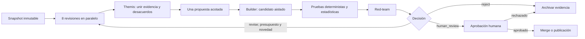

# Mejora recursiva controlada de MacroFlow

## Propósito

CALIOPE coordina iteraciones de investigación sobre MacroFlow. La recursividad
significa que una evidencia nueva puede originar una segunda revisión enfocada;
no significa que un modelo pueda modificarse, llamarse a sí mismo, publicar o
operar de manera autónoma.

El flujo se encuentra en estado **`specification_only`**: define el contrato que
debe implementar el adaptador de cada proveedor y no afirma que el motor Themis
actual ya haga cumplir todas las compuertas.

## Roles mínimos

| Componente | Responsabilidad | No puede hacer |
|---|---|---|
| Perplexity | Contexto de mercado, calendario, sesiones y fuentes actuales | Cambiar código o decidir una entrada |
| DeepSeek | Matemática de ejecución, riesgo, sizing, stops, costes y parciales | Emitir o promover un parche |
| Qwen | Pine v6, causalidad, `request.security`, estados `na` y revisión estática | Aplicar un parche al baseline |
| Z.ai | Red-team: regímenes adversos, sobreajuste, señales escasas y escenarios de fallo | Abrir otra ronda |
| Kimi | Walk-forward, bootstrap, sesgo de selección y holdout ciego | Emitir un parche o reutilizar el holdout para rediseñar |
| Gemini | Seguridad del sistema, límites research/paper/live y pruebas de caos | Emitir un parche, habilitar ejecución o auto-aprobación |
| Meta AI | Máquina de estados, carreras, invariantes y rollback | Cambiar el estado activo |
| NVIDIA Nemotron/NIM | DAG de agentes, presupuestos, Guardrails y tareas aptas para GPU | Emitir parches, promover modelos u operar |
| Claude/Themis | Plan, libro de evidencia, deduplicación, síntesis y decisión de flujo | Saltarse gates o aprobar publicación |
| Verificadores deterministas | Hashes, compilación, invariantes y comparación estadística | Interpretar narrativas de los modelos |
| Persona | Aprobar `merge`, publicación y cualquier activación operativa | — |

## Ciclo

Cada ejecución genera como máximo dos iteraciones y dos candidatos. La segunda
iteración recibe el `diff`, los fallos de gates y evidencia nueva, no todo el
historial. Esto reduce tokens y evita que los modelos repitan la misma opinión.

## Contrato entre agentes

Los agentes no se envían texto libre entre sí. Los ocho revisores externos
entregan observaciones; ninguno puede suministrar un diff. Los artefactos se
validan contra:

- `contracts/observation.schema.json`: hechos, inferencias, evidencia e
  incertidumbre.
- `contracts/proposal.schema.json`: salida futura del builder determinista con
  hipótesis, parche acotado, invariantes, pruebas y rollback.
- `contracts/decision.schema.json`: resultado de cada gate y decisión final.
- `contracts/approval.schema.json`: autorización humana firmada por hash y con
  alcance limitado a merge, publicación o paper trade.

Todo artefacto incluye `run_id`, `iteration`, hashes de entrada y referencias de
evidencia. Un hallazgo sin evidencia puede conservarse como hipótesis, pero no
puede justificar un parche ni superar un gate.

## Barreras contra ciclos y deriva

1. Solo CALIOPE avanza el DAG; los modelos únicamente sugieren hasta tres tareas.
2. El baseline es inmutable. Los cambios se aplican en `candidates/<run_id>/`.
3. Se detiene si se repite el hash de evidencia, no mejora la métrica primaria,
   se alcanza la segunda iteración, vence el tiempo o se agota el presupuesto.
4. Un candidato con cero operaciones no cuenta como mejora.
5. Cada ciclo admite una sola hipótesis principal. Los cambios no relacionados
   pasan a otro `run_id`.
6. Una propuesta no puede evaluar su propio éxito: los revisores de Pine,
   riesgo, estadística, seguridad y NVIDIA vuelven a revisar el candidato; las
   pruebas deterministas tienen prioridad sobre el consenso.
7. Los fallos y candidatos rechazados se conservan para impedir repetirlos.

## Gates estadísticos

La comparación utiliza exactamente el mismo símbolo, temporalidad, intervalo,
sesión, capital, comisiones, slippage y financiación que el baseline. Las salidas
parciales se agrupan por plan completo.

Antes de afirmar rentabilidad se requieren al menos 30 planes completos, tres
folds cronológicos y cinco planes por fold. Para enviar un candidato a revisión
humana exige, como mínimo:

- profit factor neto `>= 1.10` y expectativa neta `> 0`;
- drawdown máximo `<= 95%` del baseline;
- probabilidad bootstrap de `PF > 1` `>= 90%`;
- ningún fold aporta más del 60% del beneficio;
- expectativa aún positiva con costes multiplicados por 1.5;
- compilación Pine v6, ausencia de repaint nuevo y preservación de inputs y de
  la identidad del plan.

Si no existe muestra suficiente, el resultado es diagnóstico. CALIOPE puede
proponer una prueba posterior, pero no promover ni anunciar rentabilidad.

## Aprobación y operación

La única salida automática posible es `reject` o `revise`. `human_review` crea
un paquete revisable con hashes, diff, métricas, costes, desacuerdos y rollback.
La aprobación humana se registra por alcance: merge, publicación o paper trade.
La activación de trading real requiere una política separada futura y nunca se
hereda de una aprobación de código. Las credenciales y el envío de órdenes están
fuera de este workflow.

## Próximo trabajo de implementación

1. Crear adaptadores autorizados para cada proveedor que produzcan observaciones
   contractuales sin acceso a secretos ni ejecución.
2. Implementar `evidence_merge`, el builder determinista y el registro de un
   candidato antes de habilitar `human_review`.
3. Integrar compilación, paridad Pine↔Python y validación estadística como gates
   mecánicos reproducibles.
4. Mantener la suite de carreras, hashes, presupuestos, snapshots y aprobación
   humana como requisito de cada cambio del runner.

